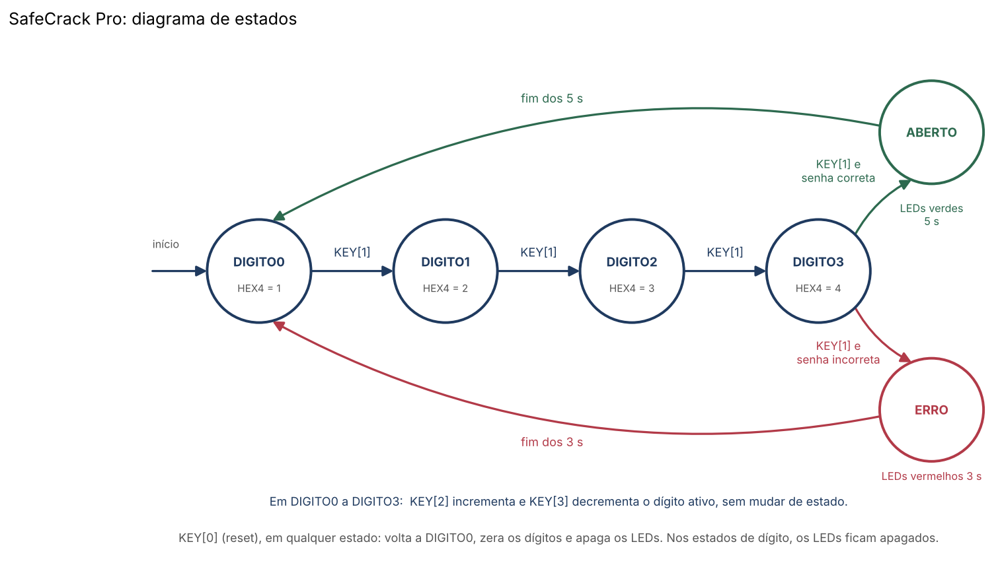
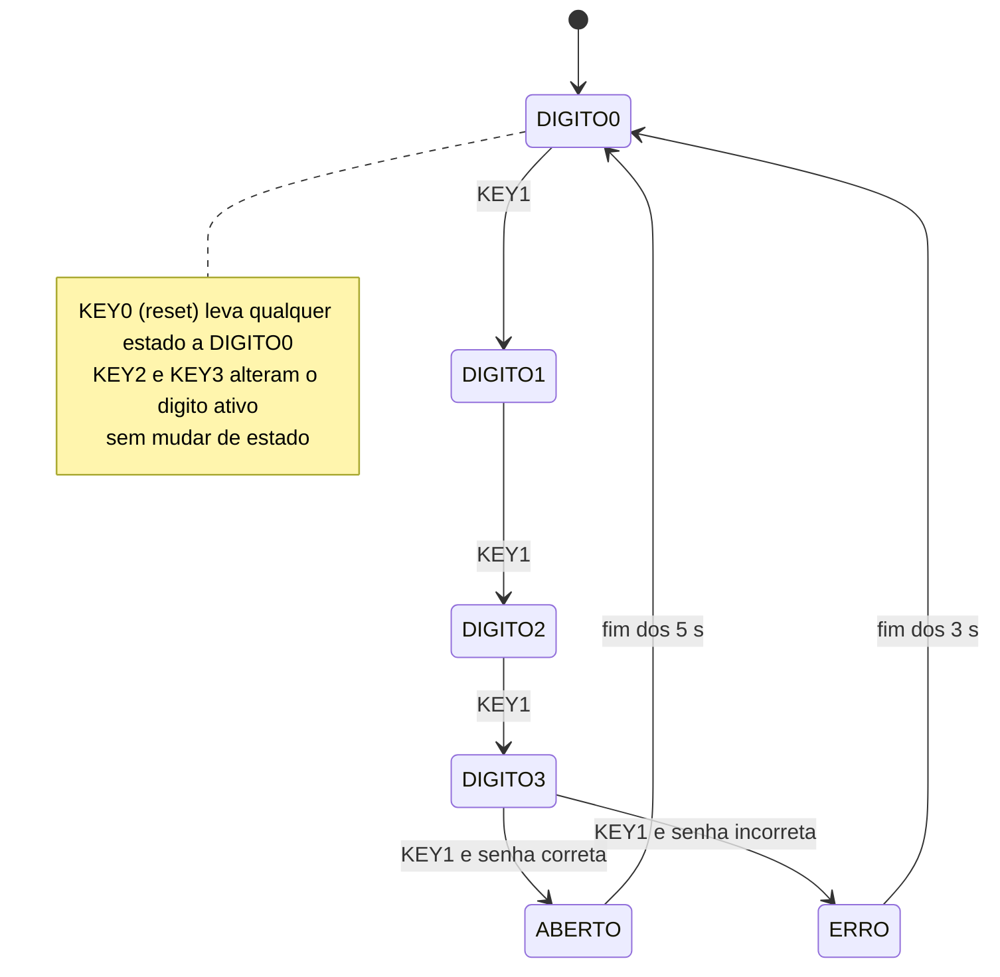
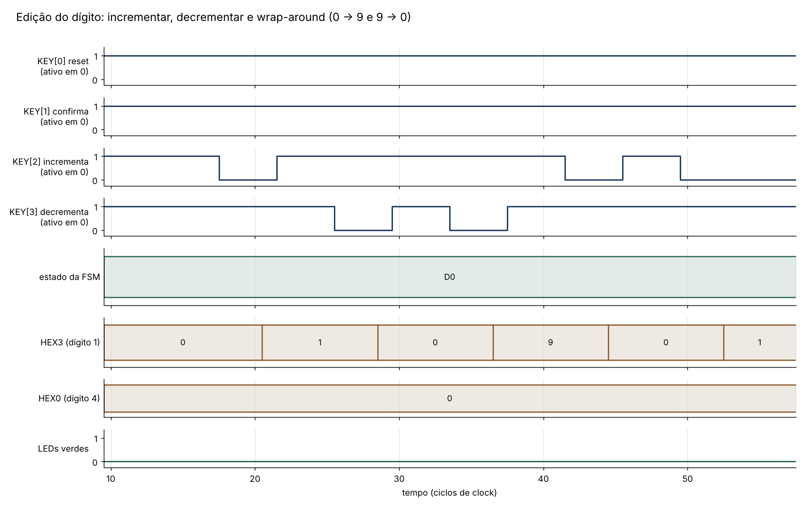
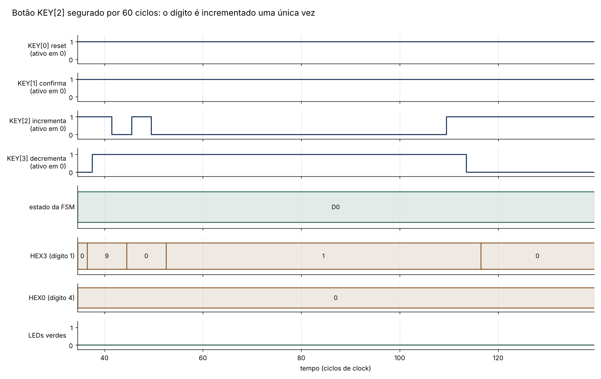
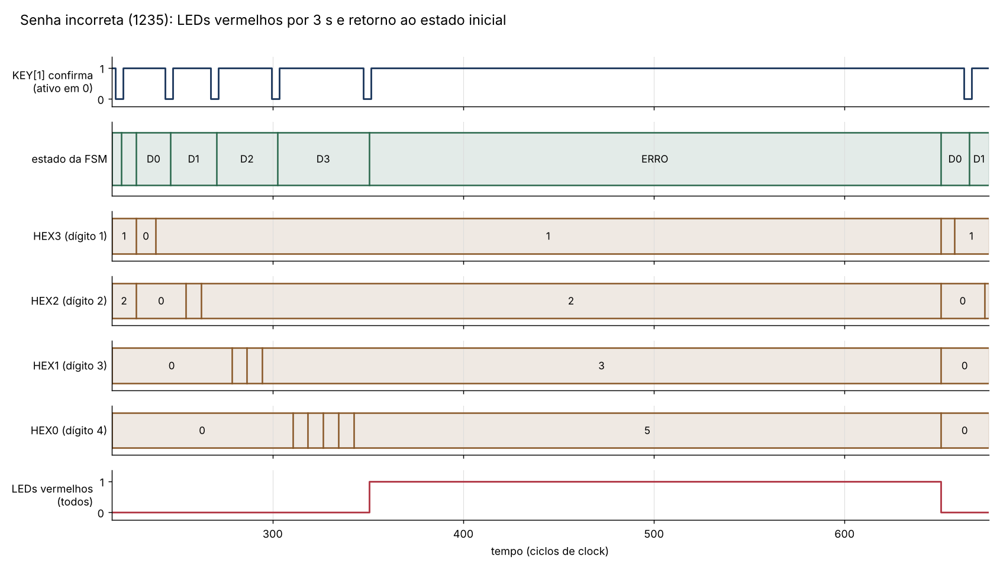
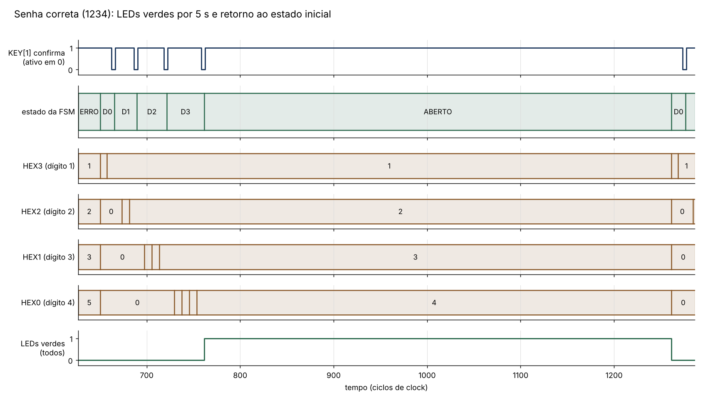
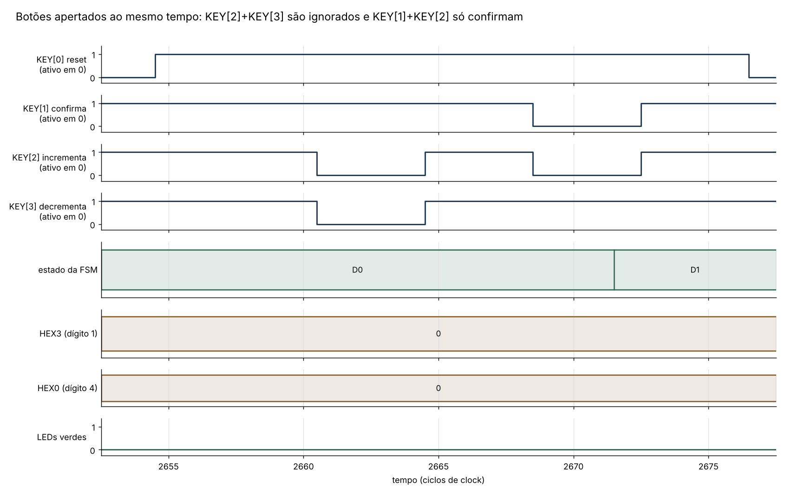

# SafeCrack Pro

Cofre digital com seleção de dígitos por push buttons e displays de 7 segmentos, implementado em SystemVerilog para a placa DE2-115 (Cyclone IV E, EP4CE115F29C7).

**Disciplina:** CIN0130 - Sistemas Digitais (2026.1) · **Professor:** Victor Medeiros

**Grupo:** Luiza Severo, Beatriz Novo, Clara Galamba, Beatriz Holanda e Maria Lucia Fragoso

---

## Como o cofre funciona

A senha tem quatro dígitos de 0 a 9. Os dígitos aparecem em HEX3 (primeiro) a HEX0 (quarto), e o HEX4 mostra qual dígito está sendo editado. O usuário escolhe um dígito por vez e confirma, até confirmar o quarto, quando o cofre compara a tentativa com a senha correta.

| Botão | Função |
|---|---|
| `KEY[3]` | decrementa o dígito ativo (0 volta para 9) |
| `KEY[2]` | incrementa o dígito ativo (9 volta para 0) |
| `KEY[1]` | confirma o dígito e avança para o próximo; no quarto dígito, verifica a senha |
| `KEY[0]` | reset: primeiro dígito ativo, displays em 0, LEDs apagados |

Resultado da verificação:

- **Senha correta:** todos os LEDs verdes (`LEDG[8:0]`) acesos por 5 s, depois o sistema volta ao início.
- **Senha incorreta:** todos os LEDs vermelhos (`LEDR[17:0]`) acesos por 3 s, depois o sistema volta ao início.

A senha padrão é **1234** e é definida pelo parâmetro `SENHA` em `rtl/safecrack_top.sv`.

---

## Estrutura do repositório

```
rtl/
  safecrack_top.sv    módulo de topo, com os nomes de pinos da DE2-115
  safecrack_fsm.sv    FSM, armazenamento dos dígitos, comparação e temporização
  btn_sync.sv         sincronizador e detector de borda dos botões
  seg7.sv             decodificador de 7 segmentos
sim/
  tb_safecrack.sv     testbench com verificações automáticas
  rodar.sh            compila, simula (Icarus Verilog) e gera as imagens
  simulate.do         script do ModelSim/Questa para ver as waveforms na janela Wave
  plot_waves.py       gera as imagens das waveforms a partir do VCD
  diagrama_estados.py gera a imagem do diagrama de estados
quartus/
  safecrack.qpf/.qsf  projeto do Quartus com os pinos da DE2-115
  safecrack.sdc       restrição de clock (50 MHz)
docs/
  diagrama_estados.png  diagrama de estados
  waveform_*.png        waveforms da simulação
  roteiro_video.md      sugestão de divisão de falas para o vídeo
```

---

## Como cada requisito foi implementado

| Requisito | Implementação |
|---|---|
| Senha de 4 dígitos, de 0 a 9 | Registrador `dig` de 16 bits, quatro dígitos de 4 bits. Só são alterados pelo incremento e decremento com wrap-around. |
| Dígitos em HEX3 a HEX0 | `safecrack_top` liga `dig0` (primeiro dígito) a HEX3, `dig1` a HEX2, `dig2` a HEX1 e `dig3` a HEX0, cada um por uma instância de `seg7`. |
| Início com tudo em 0 e primeiro dígito ativo | Valor inicial dos registradores (`dig = 0`, `state = DIGITO0`) e reset. |
| KEY[3] decrementa e KEY[2] incrementa, com wrap-around | Em `safecrack_fsm`, no dígito apontado por `idx`: `9 + 1 = 0` e `0 - 1 = 9`. |
| KEY[1] confirma e avança | Cada estado `DIGITOn` passa para `DIGITO(n+1)` no pulso de `KEY[1]`. No `DIGITO3` o pulso dispara a verificação. |
| KEY[0] reset em qualquer estado | O reset tem prioridade sobre todo o resto, em qualquer estado, e zera os dígitos e o contador. |
| Sem retorno a dígito confirmado | A FSM só tem transições para frente. Voltar exige o reset. |
| Um pressionamento = uma ação | `btn_sync` gera um pulso de um ciclo só na borda de descida do botão. Segurar o botão não repete a ação. |
| Verificação da senha | Comparação `dig == SENHA` no momento da confirmação do quarto dígito. |
| Senha correta: LEDs verdes por 5 s | Estado `ABERTO`, com contador de `5 * CLK_HZ` ciclos. |
| Senha incorreta: LED vermelho por 3 s | Estado `ERRO`, com contador de `3 * CLK_HZ` ciclos. |
| Retorno ao estado inicial | Ao fim do contador a FSM volta a `DIGITO0` e os dígitos são zerados. |
| HEX4 indica o dígito ativo | HEX4 mostra o índice do dígito em edição, de 1 a 4. |

---

## Arquitetura

```
KEY[3:0] ──► btn_sync x4 ──► pulsos (inc, dec, ok) e nível (rst) ──► safecrack_fsm ──► dig0..dig3, idx, LEDs
                                                                          │
                                                       safecrack_top ──► seg7 x5 ──► HEX0..HEX4
```

**`btn_sync`:** os botões são assíncronos em relação ao clock, então passam por dois flip-flops (sincronizador) antes de serem usados. Depois, um terceiro flip-flop guarda o valor anterior, e `pulse = atual & ~anterior` vale 1 durante um único ciclo, só quando o botão acabou de ser apertado. A entrada é invertida porque os botões são ativos em nível baixo.

**`safecrack_fsm`:** guarda o estado, os quatro dígitos e o contador de tempo.
- O próximo estado e o próximo valor do contador são calculados em um bloco combinacional.
- Um bloco sequencial atualiza o estado, o contador e os dígitos a cada clock.
- O contador é carregado com `5 * CLK_HZ` ou `3 * CLK_HZ` ao entrar em `ABERTO` ou `ERRO` e decrementa até acabar. Com `CLK_HZ = 50_000_000` isso dá 250 milhões e 150 milhões de ciclos.

**`seg7`:** converte 0 a 9 nos sete segmentos. Os displays da DE2-115 são ativos em nível baixo (0 acende o segmento). O sinal `blank` apaga o display.

---

## Diagrama de estados



<details>
<summary>Versão em Mermaid (o GitHub desenha sozinho)</summary>



</details>

| Estado | Dígito ativo (HEX4) | LEDs | Ações |
|---|---|---|---|
| `DIGITO0` | 1 | apagados | KEY2 incrementa, KEY3 decrementa, KEY1 avança |
| `DIGITO1` | 2 | apagados | idem |
| `DIGITO2` | 3 | apagados | idem |
| `DIGITO3` | 4 | apagados | idem; KEY1 verifica a senha |
| `ABERTO` | apagado | verdes acesos | botões ignorados, exceto o reset |
| `ERRO` | apagado | vermelhos acesos | botões ignorados, exceto o reset |

---

## Simulação

O testbench `sim/tb_safecrack.sv` instancia o `safecrack_top` com `CLK_HZ = 100`, para que 5 s sejam 500 ciclos e 3 s sejam 300 ciclos. A lógica é a mesma da versão de 50 MHz, só muda o valor do contador. O testbench aperta os botões, confere os displays e LEDs e mede a duração exata dos LEDs.

Para rodar com o Icarus Verilog (e gerar as imagens com Python e matplotlib):

```
sim/rodar.sh
```

Para ver as waveforms no ModelSim/Questa, abra o programa na pasta `sim` e rode:

```
do simulate.do
```

Resultado: **43 verificações, todas passando.**

| Teste | O que verifica |
|---|---|
| T1 | displays em 0000, HEX4 no primeiro dígito, LEDs apagados |
| T2 | incremento, decremento e wrap-around (0 para 9 e 9 para 0) |
| T3 | botão segurado por 60 ciclos altera o dígito uma única vez |
| T4 | KEY1 avança o dígito ativo (HEX4 mostra 2, 3 e 4) |
| T5 | reset no meio da digitação |
| T6 | senha incorreta: LEDs vermelhos por exatamente 3 s, retorno ao início |
| T7 | senha correta: LEDs verdes por exatamente 5 s, retorno ao início |
| T8 | reset durante o feedback apaga os LEDs na hora |
| T9 | uma tentativa errada seguida de uma correta |
| T10 | botões apertados ao mesmo tempo (KEY[2]+KEY[3] e KEY[1]+KEY[2]) |
| T11 | reset durante o erro apaga os LEDs vermelhos na hora |
| T12 | botões ignorados durante o feedback e contagem de 5 s não alterada |

Nas imagens, `D0` a `D3` são os estados `DIGITO0` a `DIGITO3`, e o tempo está em ciclos de clock.

### Edição do dígito e wrap-around
Cada pulso baixo em KEY[2] soma 1, e em KEY[3] subtrai 1. O dígito vai de 0 para 9 ao decrementar e volta de 9 para 0 ao incrementar.



### Botão segurado
KEY[2] fica em nível baixo por 60 ciclos e o dígito muda apenas uma vez. Depois, KEY[3] é apertado e o dígito volta a 0.



### Senha incorreta
São digitados 1, 2, 3 e 5. Ao confirmar o quarto dígito, a FSM vai para `ERRO` e os LEDs vermelhos ficam acesos por 300 ciclos, que equivalem aos 3 s. Os dígitos ficam visíveis durante o erro e são zerados quando a FSM volta ao início.



### Senha correta
São digitados 1, 2, 3 e 4. A FSM vai para `ABERTO` e os LEDs verdes ficam acesos por 500 ciclos, que equivalem aos 5 s.



### Botões apertados ao mesmo tempo
KEY[2] e KEY[3] juntos são ignorados e o dígito não muda. KEY[1] e KEY[2] juntos só confirmam: a FSM avança para o segundo dígito e o valor do primeiro continua 0. (O estado volta a `D0` no fim da janela porque o teste seguinte aperta o reset.)



---

## Como gravar na placa

1. Abra `quartus/safecrack.qpf` no Quartus. O projeto já traz o dispositivo, os arquivos `.sv` e os pinos.
2. Compile (Processing > Start Compilation).
3. Conecte a DE2-115 por USB, abra o Programmer e grave o arquivo `.sof` gerado.

Pinos usados (conforme o manual da DE2-115): `CLOCK_50` em `PIN_Y2`; `KEY[0..3]` em `PIN_M23`, `PIN_M21`, `PIN_N21`, `PIN_R24`; `HEX0` a `HEX4`, `LEDG[8:0]` e `LEDR[17:0]` conforme `quartus/safecrack.qsf`.

### Teste na placa

- [ ] Ao ligar, displays em 0000 e HEX4 mostrando 1
- [ ] KEY[2] e KEY[3] alteram o dígito ativo, com wrap-around
- [ ] Segurar um botão não repete a ação
- [ ] KEY[1] avança o dígito ativo (HEX4 mostra 1, 2, 3, 4)
- [ ] Senha 1234: LEDs verdes por 5 s
- [ ] Senha errada: LEDs vermelhos por 3 s
- [ ] KEY[0] reinicia em qualquer momento

---

## Decisões de projeto

- **HEX4 mostra o índice de 1 a 4** (o enunciado não define se começa em 0 ou 1). Para trocar para 0 a 3, retire o `+ 4'd1` de `idx_exibido` em `safecrack_top.sv`.
- **HEX4 apaga durante o feedback**, porque nenhum dígito está sendo editado.
- **Os dígitos continuam visíveis durante `ABERTO` e `ERRO`** e só voltam a 0 ao retornar ao estado inicial, como pede o enunciado.
- **Todos os LEDs vermelhos acendem no erro** (o enunciado diz "o(s) LED(s) vermelho(s)").
- **Botões simultâneos:** se KEY[1] chegar junto com KEY[2] ou KEY[3], só a confirmação vale. Se KEY[2] e KEY[3] chegarem juntos, os dois são ignorados.
- **Sem verificação separada:** a comparação é feita direto na transição de `DIGITO3`, porque o quarto dígito já está no valor final quando KEY[1] é apertado.

---

## Known issues

- **Debounce:** o código não faz debounce por software. Segundo o manual da DE2-115, os push buttons já são filtrados por circuito Schmitt trigger na própria placa. Se algum botão apresentar duplo clique na prática, o `btn_sync` é o lugar para incluir um filtro por contador.
- **Reset com atraso de poucos ciclos:** o reset passa pelo sincronizador e é aplicado em cerca de 2 ciclos de clock (40 ns). Não é perceptível para o usuário.
- **Simulação em escala reduzida:** a simulação usa `CLK_HZ = 100` para não precisar simular 250 milhões de ciclos. A temporização em 50 MHz depende da mesma conta (`5 * CLK_HZ`), mas só pode ser confirmada na placa.
- **Botão do reset segurado:** enquanto KEY[0] estiver apertado, a FSM fica presa em `DIGITO0` e ignora os outros botões. Ao soltar, o uso volta ao normal.
- **Senha fixa em tempo de compilação:** para trocar a senha é preciso alterar o parâmetro `SENHA` e recompilar.
